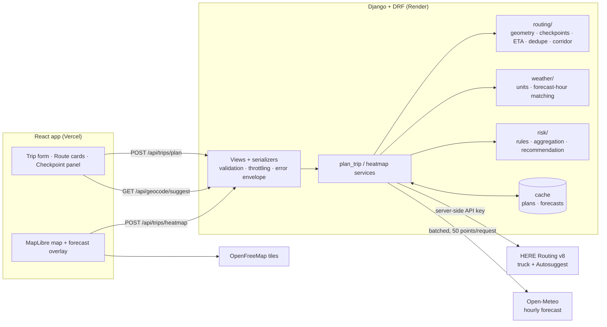

# Weather-Aware Truck Routing — Django REST Framework + React

Plan a truck trip and compare up to **three real truck routes** by the weather the driver will actually meet.
The forecast is taken at each checkpoint's **estimated arrival time**, the assignment's wind/rain/snow and
**load-weight rules** are applied, and the app recommends a route with a written, rule-by-rule rationale. A corridor
**weather heatmap with a 0–48 h slider** shows how conditions evolve along the trip.

| | |
|---|---|
| **Live app** | _add the Vercel URL after deploying_ |
| **API health** | _add the Render URL_ `/api/health` |
| **Walkthrough** | _add the Loom link_ |

| Layer | Stack |
|---|---|
| Backend | Python 3.12 · **Django 5.2** · **Django REST Framework** · httpx |
| Frontend | **React** · TypeScript · Vite · Tailwind CSS · TanStack Query · MapLibre GL JS |
| Providers | HERE Routing v8 (truck mode) + Autosuggest · Open-Meteo hourly forecast · OpenFreeMap tiles |
| Quality | 174 pytest tests (100 % branch coverage on the rule engine) · 55 Vitest/RTL tests · GitHub Actions CI |

---

## What it does

1. **Input:** origin and destination (address autocomplete), departure date/time, load weight (lb), and a checkpoint
   interval of 10, 25 or 50 miles.
2. **Routes:** HERE truck routing with the truck's gross weight. Up to 5 alternatives are requested and near-duplicates
   removed, so the routes shown are genuinely different roads.
3. **Checkpoints and ETAs:** a checkpoint every N road miles plus origin and destination. ETAs come from HERE's
   per-segment travel times, not one average speed.
4. **Weather at ETA:** each checkpoint gets the hourly forecast for the hour it will be driven, never "current weather".
5. **Risk:** exact thresholds plus the load rules. Every checkpoint lists which rule set its level.
6. **Recommendation:** strict lexicographic ranking with a one-line reason per runner-up, e.g.
   *"Route B beats Route A: fewer Severe-or-worse miles (0.0 mi vs 12.5 mi)."*
7. **Map:** all routes, risk-coloured checkpoints, selected-checkpoint details, route summaries, and a corridor
   weather overlay you can scrub (or play) from departure to +48 h.

## Architecture



* **The business logic is plain Python** (`routing/`, `weather/`, `risk/`): pure functions with no Django or HTTP code,
  so every rule is unit-tested directly.
* **Providers** (`providers/`) are thin clients with timeouts, one retry on transient errors, and typed errors that the
  API turns into a uniform `{"error": {code, message}}` response without leaking internals.
* **Keys never reach the browser.** Address search is proxied through Django.
* **Stateless:** no database models. Plans and forecasts are cached in-process, so the heatmap request reuses the plan
  instead of calling HERE again.

## How the logic works

### Risk rules (`backend/risk/rules.py`)

| Level | Wind (mph) | Rain (in/h) | Snow (in/h) |
|---|---|---|---|
| Low | < 25 | < 0.10 | < 0.5 |
| Moderate | 25 – < 35 | 0.10 – < 0.25 | 0.5 – < 1.0 |
| High | 35 – < 45 | 0.25 – < 0.50 | 1.0 – < 2.0 |
| Severe | 45 – < 55 | 0.50 – 1.00 | 2.0 – 3.0 |
| No Travel | ≥ 55 | > 1.00 | > 3.0 |

Load rules: wind ≥ 55 → No Travel for any load; 45–54 mph with > 30,000 lb → No Travel; 35–44 mph with > 40,000 lb →
at least Severe. A checkpoint's level is the highest level any rule produces. Every boundary is tested exactly at the
value and just below and just above it.

### Forecast at the checkpoint's ETA (`backend/weather/matching.py`)
* Open-Meteo precipitation is the **sum over the preceding hour**, so a checkpoint uses the hourly record whose window
  contains its ETA (ETA rounded up to the hour). Wind is instantaneous and linearly interpolated between hours.
* Wind uses sustained 10 m wind. Gusts are shown but not scored, because the rules don't mention them.
* No forecast for that time (beyond the horizon, or missing data) → **Unknown**. It is never assumed Low.

### Risk miles and ranking (`backend/risk/aggregate.py`, `recommend.py`)
* Each checkpoint represents the road between the midpoints with its neighbours, so these stretches add up exactly to
  the route length. Average risk is the distance-weighted mean on Low 0 … No Travel 4. Unknown miles are reported
  separately.
* Routes are sorted by a strict tuple (no weighted score):
  0. **No Travel gate:** a route with any No Travel miles never beats one without; if all have some, fewest wins and
     the app says *"No route is confirmed safe."*
  1. fewest **Severe** miles (Severe-or-worse) → 2. fewest **High** miles → 3. lowest **average risk** →
     4. shortest **travel time**.

  Why the gate: read literally, the rules would rank 5 No Travel miles ahead of 10 Severe miles, recommending a road the
  rules forbid.

### Corridor heatmap (`backend/routing/corridor.py`, `frontend/src/features/forecast/`)
* A grid of points spaced evenly in **miles** (~15–20 mi, ≤ 600 points) within 40 mi of every route, with hourly
  forecasts for +0…+48 h and risk scored by the same rules and load.
* Drawn as soft overlapping discs coloured by each point's own value. Colour therefore always matches the legend,
  unlike density heatmaps where colour depends on point overlap. The legend says the field is interpolated between
  points, not observed.
* The data is uploaded to the map **once per trip**. The slider only swaps paint expressions, so scrubbing stays smooth
  and never re-renders the sidebar.

All assumptions and their reasons: **[docs/assumptions.md](docs/assumptions.md)**.

## API

| Method | Path | Purpose |
|---|---|---|
| `POST` | `/api/trips/plan` | Routes, checkpoints (ETA, weather, risk, factors), summaries, recommendation, notices |
| `POST` | `/api/trips/heatmap` | Corridor grid with 49 hourly values per point (same body as `/plan`) |
| `GET` | `/api/geocode/suggest?q=` | Address autocomplete (HERE, proxied) |
| `GET` | `/api/health` | Liveness |

```json
POST /api/trips/plan
{
  "origin": {"lat": 41.8781, "lon": -87.6298, "label": "Chicago, IL"},
  "destination": {"lat": 39.7392, "lon": -104.9903, "label": "Denver, CO"},
  "departure_time": "2026-10-12T11:00:00Z",
  "load_weight_lb": 42000,
  "sample_interval_mi": 25
}
```

Response (abridged):

```json
{
  "recommendation": {
    "route_id": "r2", "ranking": ["r2", "r3", "r1"], "all_routes_unsafe": false,
    "rationale": ["Route B beats Route A: fewer No Travel miles (0.0 mi vs 50.0 mi)."]
  },
  "routes": [{
    "id": "r1", "label": "Route A", "distance_mi": 1003.2, "duration_s": 54000,
    "summary": {"severe_or_worse_miles": 100.0, "no_travel_miles": 50.0, "high_miles": 25.0, "avg_risk": 0.46, "...": "..."},
    "checkpoints": [{
      "seq": 19, "mile": 475.0, "eta": "2026-10-12T19:48:00Z",
      "weather": {"status": "ok", "time": "2026-10-12T20:00:00Z", "wind_mph": 44.0, "gust_mph": 60.0, "rain_in_hr": 0.39, "snow_in_hr": 0.0},
      "risk": {"level": "SEVERE", "factors": {"wind": "HIGH", "rain": "HIGH", "load": "SEVERE"}}
    }]
  }],
  "notices": []
}
```

Errors always use one shape: `{"error": {"code": "VALIDATION" | "NO_ROUTE" | "UPSTREAM_TIMEOUT" | ..., "message": "...", "fields"?: {...}}}`,
with 400, 422, 429, 502 or 504.

## Run locally

**Prerequisites:** Python 3.12, Node 20, a free [HERE API key](https://platform.here.com) (Open-Meteo needs no key).

```bash
# Backend: Django + DRF on http://localhost:8000
cd backend
python3.12 -m venv .venv && source .venv/bin/activate
pip install -r requirements-dev.txt
cp .env.example .env              # set HERE_API_KEY
python manage.py runserver
python manage.py smoke_plan       # optional: live end-to-end check (Chicago -> Denver)

# Frontend: React on http://localhost:5173
cd frontend
npm install
cp .env.example .env              # VITE_API_BASE_URL=http://localhost:8000/api
npm run dev
```

## Tests and quality

```bash
cd backend  && ruff check . && pytest --cov           # 174 tests
cd frontend && npm run lint && npm test && npm run build   # 55 tests, typecheck + build
```

* **Backend:**
  * rule boundaries and the load-rule matrix;
  * checkpoint spacing and destination inclusion;
  * span-based ETAs and forecast-hour matching;
  * risk-mile aggregation and every ranking tie-break;
  * all routes unsafe, unknown forecasts, duplicate or too few routes, provider timeouts, partial weather outages;
  * validation and the error envelope.
* **Frontend:**
  * form validation and autocomplete (mouse and keyboard);
  * loading, error and partial-data states;
  * route/map/table/panel selection sync;
  * slider and metric behaviour, checking that the slider swaps paint expressions without re-uploading data.
* Frontend fixtures are generated from the real Django endpoints, so the tests use the exact API contract.
* CI runs both suites on every push (`.github/workflows/ci.yml`).

## Deployment

Backend on **Render** (`render.yaml` blueprint), frontend on **Vercel** (`frontend/vercel.json`).
Step-by-step instructions: **[docs/deployment.md](docs/deployment.md)**.

## Known limitations

* **Forecast skill and horizon:** forecasts are less reliable beyond about 3 days and are interpolated from 3-hourly
  data after day 5. Departures are limited to the next 13 days, and anything past the provider horizon is shown as
  Unknown.
* **Sampling:** a small storm cell between two checkpoints can be missed. A 10-mile interval reduces this.
* **ETAs** use HERE's typical speeds for the departure time. Hours-of-service breaks, fuel stops and weather slow-downs
  are not modelled.
* **Free tiers:** Render sleeps when idle (first request ~30–60 s; the app pings on load to wake it). Open-Meteo's free
  tier allows 10,000 calls/day. Whether multi-location requests count per location is undocumented, so heatmaps are
  cached and degrade gracefully if throttled.
* **Coverage:** address search is limited to the US and Canada, matching the mph/inch units and HRRR/GFS coverage.

## Data and attribution

Routing and geocoding © HERE. Weather data by [Open-Meteo.com](https://open-meteo.com) (CC BY 4.0). Map tiles by
[OpenFreeMap](https://openfreemap.org), © [OpenMapTiles](https://openmaptiles.org), data ©
[OpenStreetMap contributors](https://www.openstreetmap.org/copyright).
